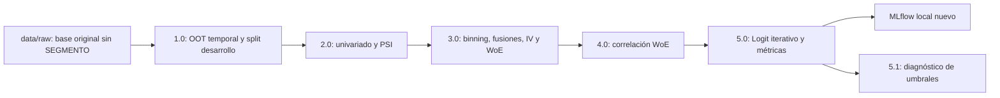

# Pipeline de riesgo crediticio desde la base original — fases 1.0–5.2

La reproducción comienza con **`notebooks/1.0.0.SCR_DES_MOD_RL_SEGMT.ipynb`**, que carga la fuente sin segmentar y construye TRAIN/TEST/OOT. No se inicia desde una partición precalculada. No requiere archivos del proyecto de origen.

## Fuente autorizada

- `data/raw/base_credit_risk_202510.csv`, separador `;`.
- 50,620 filas, **47 columnas**, sin `SEGMENTO`; 10,665,120 bytes.
- SHA256 `d8278614e2e822d871b098143317351f7ad5a8948e2970a87c348ea01eaba514`.
- Target: `indicador_default`; 1 = malo/default y 0 = bueno.
- Identificador: `cliente_id`; período: `periodo_observacion`, 202408–202510.
- Contrato completo de columnas/tipos: `configs/data_schema.json`.

La fuente original está autorizada para compartirse sin anonimización adicional. 

## Metodología original de partición — no reemplazada

El notebook 1.0 se ejecuta literalmente, en un namespace limpio:

1. Carga `base_credit_risk_202510.csv` con `sep=';'`.
2. OOT: períodos **202510, 202509 y 202508**.
3. Desarrollo: `periodo_observacion <= 202507`.
4. Solo desarrollo se divide con **`train_test_split(test_size=0.30, random_state=123, stratify=desarrollo['indicador_default'])`**.
5. Se asigna `SEGMENTO` por los índices originales, sin ordenar ni reinicializar registros.
6. Se exporta el dataframe completo con `index=False`.

La partición aleatoria existe en el notebook original: no fue inventada durante esta corrección. Su unidad es la fila de desarrollo; no se sustituye por un split global ni por uno agrupado por cliente.

| Muestra | Registros | Clientes únicos | Defaults |
| --- | ---: | ---: | ---: |
| TRAIN | 28,221 | 28,221 | 3,001 |
| TEST | 12,095 | 12,095 | 1,286 |
| OOT | 10,304 | 10,304 | 1,131 |

El archivo generado tiene 48 columnas, incluida `SEGMENTO`. 
## Estructura y arquitectura



- `notebooks/`: seis notebooks fuente, sin salidas antiguas, desde **1.0** hasta 5.1.
- `src/`: módulos estadísticos heredados, adaptador de rutas, validador de partición y frontera I/O.
- `scripts/`: `run_pipeline.py`, `ejecutar_segmentacion.py` y ejecutores posteriores.
- `tests/`: suites existentes y pruebas de partición/empaquetado.
- `configs/`: configuración central, esquema de fuente y referencia de particiones.
- `docs/reference/`: referencias de comparación, sin sustituir resultados calculados.
- `outputs/`: resultados y entorno de validación regenerables, excluidos de Git.

## Instalación verificada — Windows PowerShell

Python **3.14.4 de 64 bits**, Windows. Desde la raíz clonada:

```powershell
py -3.14 -m venv .venv
.\.venv\Scripts\python.exe -m pip install --upgrade pip
.\.venv\Scripts\python.exe -m pip install -r requirements-lock.txt
.\.venv\Scripts\python.exe -m pip check
```

`requirements.txt` fija dependencias directas. El lock fija transitivas del entorno limpio Windows/Python 3.14.4. 
## Ejecución integral desde cero

```powershell
.\.venv\Scripts\python.exe scripts/run_pipeline.py
```

El orden predeterminado es **1 → 2 → 3 → 4 → 5 → 5.1 → MLflow → pruebas → comparación**. No requiere editar rutas. La búsqueda exhaustiva B.3 tarda varios minutos. El ejecutor usa Python secuencial y captura las tablas/figuras del notebook; no se presenta como una ejecución por kernel Jupyter interactivo.

Por etapas:

```powershell
.\.venv\Scripts\python.exe scripts/run_pipeline.py --phases 1
.\.venv\Scripts\python.exe scripts/run_pipeline.py --phases 2
.\.venv\Scripts\python.exe scripts/run_pipeline.py --phases 3
.\.venv\Scripts\python.exe scripts/run_pipeline.py --phases 4 5
.\.venv\Scripts\python.exe scripts/run_pipeline.py --phases 5.1
.\.venv\Scripts\python.exe scripts/run_pipeline.py --phases mlflow tests validate
```

Fases específicas posteriores necesitan las salidas de sus predecesoras. No se acepta iniciar fase 2 con un CSV precalculado sin evidencia de fase 1. Si cambias una configuración metodológica, la comparación con la referencia original puede fallar legítimamente; no se ajustan datos para forzar coincidencia.

## Notebooks interactivos

```powershell
.\.venv\Scripts\python.exe -m jupyterlab notebooks
```

Seleccionar el entorno `.venv`. Ejecutar secuencialmente:

1. **1.0.0.SCR_DES_MOD_RL_SEGMT.ipynb**: carga, resumen por período, OOT temporal, split estratificado de desarrollo y exportación/validación de segmentos.
2. **2.0.0.SCR_DES_ANLS_UNV_BIV_MULT.ipynb**: concentración >85%, nulos >40%, PSI mensual early TRAIN de tres meses; sin descarte físico automático por PSI.
3. **3.0.0.SCR_DES_ANLS_BIVARIADO.ipynb**: q2–q10, fusiones contiguas TRAIN, IV/WoE B.3, dashboards congelados.
4. **4.0.0.SCR_DES_ANLS_Multivar.ipynb**: Pearson absoluto >0.60 y prioridad IV.
5. **5.0.0.SCR_DES_MODELO_LOGISTICO.ipynb**: IV >0.50, Logit por signo, p-value y SHAP; resumen statsmodels y métricas.
6. **5.1.0.SCR_DES_EVALUACION_UMBRALES.ipynb**: diagnóstico complementario sin reentrenar. Su submuestra interna TRAIN no es una validación independiente del ajuste.


## Configuración y validaciones

`configs/pipeline.json` mantiene los valores originales: rutas, target, segmentos, período, definición explícita de segmentación, univariado, PSI, binning/fusiones/IV, correlación, Logit, SHAP y MLflow. Los criterios de partición siguen en el código literal del notebook original; la configuración los documenta y la instrumentación comprueba que la llamada real coincide. No se redefine la partición desde un split genérico del orquestador.

`segmentation_validation.py` no crea muestras: compara la salida generada con los hashes originales y el contrato de `partition_reference.json`. Verifica conteos, períodos, clientes, distribución del target, columnas, tipos, índices, IDs y hashes de todas las filas por segmento. El hash del archivo completo prueba igualdad byte a byte con la salida original en el entorno verificado.

`pipeline_io_guard.py` bloquea lecturas/listados del proyecto de origen, también en subprocesos Python mediante `sitecustomize` y PYTHONPATH del repositorio. El log en `outputs/access_audit/` permite verificar intentos bloqueados; la ejecución no necesita acceder al proyecto original.

## Resultados generados

En `outputs/workspace_from_raw/`:

- `1.base/base_credit_risk_202510.csv`: copia runtime de la fuente original autorizada.
- `2.OUTPUT/1.1.0.TAB_SEGM_TRAIN_TEST_OOT.csv`: **generado por fase 1**, no una entrada versionada.
- `1.SEGMENTACION/evidencias/particiones_verificadas.json`: auditoría exacta de la partición.
- `4.ANALIS_UV_BV_MV/PSI_TEMPORAL/`: univariado, PSI y figuras.
- `4.ANALIS_UV_BV_MV/BIVARIADO/`: bins/cortes/WoE, matrices y estados B.3.
- `4.ANALIS_UV_BV_MV/MULTIVARIADO/`: correlación, descartes, selección y matrices.
- `5.MODELO_LOGISTICO/`: Logit, coeficientes, iteraciones, métricas y predicciones.
- `5.1.EVALUACION_UMBRALES/`: diagnóstico complementario.
- `MLFLOW_LOCAL/`: SQLite y artefactos nuevos.

En `outputs/executed_notebooks/` se guardan los seis notebooks ejecutados y la llamada observada al split (`phase1_split_calls.json`). `outputs/reproduction_report.json` compara cortes, coeficientes y métricas con las referencias; `outputs/tests.json` y `outputs/tests.txt` contienen las pruebas. Las referencias nunca se usan como resultados artificiales.

WoE = ln(%Buenos/%Malos), target 1=default: signo esperado negativo. No se cambia el target ni el umbral 0.50 del modelo principal. Los p-values tras selección pueden ser optimistas; los deltas de Gini/KS son reglas de seguimiento. La fase 5.1 no selecciona umbrales con TEST/OOT.
